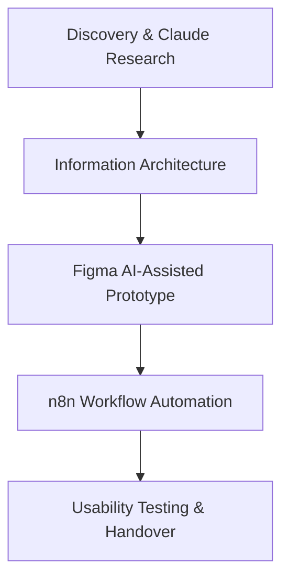

# Skill: Generador de Propuestas & Cover Letters de Alto Impacto

Esta skill ejecuta la generación en lote de propuestas para las vacantes de mayor puntaje (Highest Fit Score First), optimizadas específicamente para el comportamiento de escaneo rápido en la bandeja de entrada de clientes de Upwork.

---

## 1. Reglas Fundamentales del Flujo

Para cada vacante ordenada de mayor a menor `fitScore`:

### Paso 1: Descubrimiento de Nombre de Contacto (Contact Name Discovery)
* Escanear la descripción completa y las firmas del cliente (ej. *"thanks, Sara"*, *"Best, John"*, *"I'm Mike from Acme"*).
* **Si se encuentra el nombre:** Abrir la cover letter con ese nombre: `"Hey Sara,"` o `"Hi Sara,"`.
* **Si NO se encuentra el nombre:** Abrir con un saludo natural entre colegas: `"Hey there,"` o `"Hi,"`.
* **Regla estricta:** NUNCA usar *"Dear Sir/Madam"*, *"Dear Hiring Manager"* ni *"Hiring Team"*.

### Paso 2: Cover Letter de 35 Palabras Máximo (Above The Fold)
* **Límite psicológico:** 30 a 35 palabras en total incluyendo el enlace `[link]`.
* **Estructura fija:**
  1. **Saludo natural con nombre:** `"Hey [Name],"`
  2. **Gancho de autoridad y resultado transferible:** `"I work with [herramienta clave del trabajo] daily. Having [métrica auditada en Proof Story], I just mapped the exact technical architecture for your project."`
  3. **Llamado a la acción:** `"Free walkthrough and roadmap here: [link]."`
* **Regla de estilo:** 0 guiones largos (`—`), 0 clichés de IA, tono directo estilo Slack.

### Paso 3: Propuesta Técnica Completa en Primera Persona (5 a 6 Pasos)
Estructurada en primera persona ("I") específicamente para el proyecto del cliente, sin plantillas con huecos en blanco:
1. **Executive Summary & Diagnostic Hook:** Gancho de una sola línea demostrando que ya se analizó su caso a fondo + métrica de autoridad de la Proof Story (ej. *Pepper AI: 17k+ usuarios activos*).
2. **Desglose Técnico de 5 a 6 Pasos con Herramientas Reales:**
   * **Paso 1:** Research Synthesis & Heuristic Audit (usando *Claude* para síntesis temática y *Qualtrics* para encuestas estructuradas).
   * **Paso 2:** Information Architecture & Workflow Mapping (definición de estados de usuario y handoffs de agentes).
   * **Paso 3:** Rapid Prototyping & Component Architecture (usando *Figma & Figma Make* para tokens de diseño y componentes autolayout asistidos por IA).
   * **Paso 4:** Agentic Automation & Workflow Integration (usando *n8n* para orquestación de flujos de trabajo con agentes y webhooks).
   * **Paso 5:** Usability Testing & Iterative Hardening (pruebas estándar de usabilidad, métricas SUS y evaluación heurística).
3. **Entregables y Cronograma Realista:** Hitos por semanas (Fase 1 Semana 1, Fase 2 Semana 2) con artefactos tangibles.

### Paso 4: Diagrama de Flujo Mermaid (Máximo 6 Nodos)
Un diagrama `flowchart TD` limpio que represente los 5-6 pasos metodológicos del proyecto:


### Paso 5: Google Doc / Walkthrough Interactivo & PDF Ejecutivo
* **En Upwork:** El enlace de la cover letter abre el Walkthrough o Google Doc limpio, formateado con encabezados reales y el diagrama integrado.
* **Adjunto en Upwork:** Se adjunta el PDF generado por Gotenberg para clientes corporativos que desean archivar la propuesta.

---

## 2. Ejecución en Lote mediante API o Terminal

Para generar propuestas de forma masiva sobre todos los empleos de alto fit:

```bash
# Ejecutar síntesis para los empleos con High Fit
curl -X POST https://pepper-tix-proposal-backend.zh4nwb.easypanel.host/api/scraping/synthesize-batch \
  -H "Content-Type: application/json" \
  -d '{"minScore": 75, "overwrite": false}'
```
