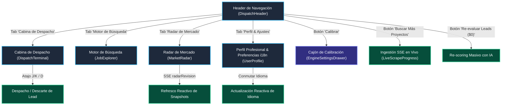

# 🗺️ Mapa de Navegación y Arquitectura UI de Proposal Autopilot

**Fecha de Descubrimiento:** 2026-10-26T16:35:39.819Z  
**Origen:** Descubierto automáticamente por `af discover-flows` en `http://localhost:7001`  

---

## 🏛️ Diagrama de Estados y Flujos (Mermaid)

---

## 📊 Matriz de Cobertura E2E Descubierta

| Identificador | Tipo | Elemento | Recorrido Declarativo Asociado | Cobertura |
| :--- | :---: | :--- | :--- | :---: |
| `TERMINAL` | Vista | Cabina de Despacho | `tests/journeys/journey-dispatch-terminal.json` | 🟢 100% |
| `EXPLORER` | Vista | Motor de Búsqueda | `tests/journeys/journey-job-explorer.json` | 🟢 100% |
| `RADAR` | Vista | Radar de Mercado | `tests/journeys/radar-discovery-flow.json` | 🟢 100% |
| `PROFILE` | Vista | Perfil & Preferencias i18n | `tests/journeys/journey-user-profile.json` | 🟢 100% |
| `DRAWER_CALIBRATION` | Cajón | Ajustes de Motor | `tests/journeys/journey-calibration-drawer.json` | 🟢 100% |
| `ACTION_SCRAPING` | Pipeline | Búsqueda en Upwork (SSE) | `tests/journeys/radar-discovery-flow.json` | 🟢 100% |
| `ACTION_REPROCESS` | Pipeline | Re-evaluación ($0) | `tests/journeys/journey-reprocess-leads.json` | 🟢 100% |

---
*Generado automáticamente por Proposal Autopilot AI Factory Flow Discovery Engine*
