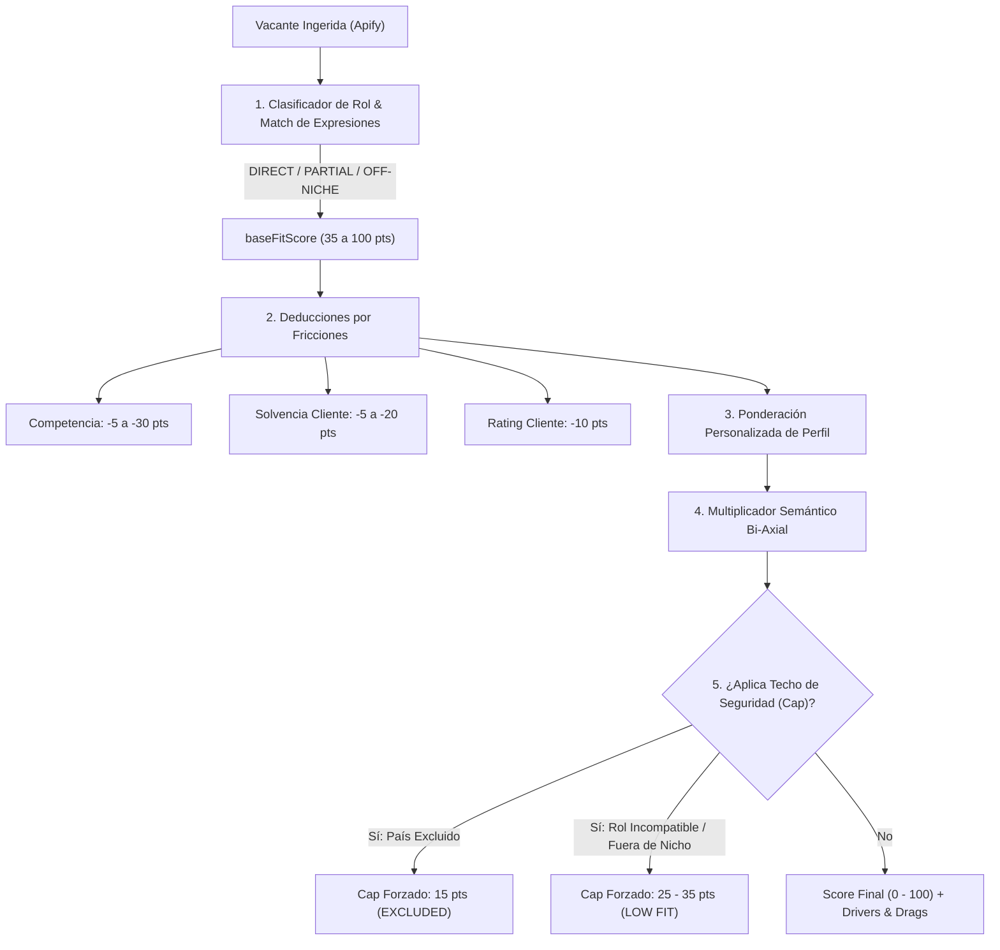

# Fit Score Engine: Especificación Integral del Algoritmo de Calificación (0 - 100)

> **Documentación Oficial de Arquitectura y Negocio**  
> **Espacio Confluence sugerido:** `Proposal Autopilot > Arquitectura & Motores Core > 01. Fit Score & Lead Qualification`  
> **Etiquetas Confluence:** `proposal-autopilot`, `scoring-algorithm`, `fit-score`, `upwork-automation`, `lead-scoring`, `production-grade`  
> **Código Fuente Principal:** [`backend/src/modules/scoring/services/fit-calculator.service.ts`](file:///d:/SpotlightProjects/proposal-autopilot/backend/src/modules/scoring/services/fit-calculator.service.ts)

---

## 1. Resumen Ejecutivo (¿Qué es el Fit Score?)

El **Fit Score (0 a 100)** es el motor predictivo que evalúa cada vacante de Upwork en menos de 2 milisegundos. Su función es responder de inmediato a la pregunta crítica del negocio:  
**¿Vale la pena invertir tiempo y créditos de IA en postular a este empleo?**

El motor clasifica el empleo en tres niveles operativos (*Semáforo de Decisión*):

| Nivel de Fit | Rango | Significado Operativo | Acción Automatizada |
| :--- | :---: | :--- | :--- |
| 🟢 **HIGH FIT** | **75 – 100** | **Oportunidad de Oro.** Alta afinidad técnica, cliente solvente, baja fricción de competencia y publicación fresca. | Se pre-genera propuesta técnica a la medida, diagrama Mermaid y CV optimizado. |
| 🟡 **MEDIUM FIT** | **45 – 74** | **Oportunidad Aceptable.** Cumple criterios base, pero presenta fricción (ej. >15 propuestas, cliente nuevo o presupuesto moderado). | Disponible para revisión y generación de propuesta bajo demanda (1 clic). |
| 🔴 **LOW FIT** | **0 – 44** | **Ruido o Descalificado.** Empleo saturado (>50 propuestas), país excluido, cliente no verificado o rol no compatible. | Se filtra del pipeline activo para no quemar tokens ni connects. |

---

## 2. Arquitectura de Calificación: Enfoque Deductivo Bi-Axial

A diferencia de modelos ingenuos que suman puntos ciegamente, el motor de Proposal Autopilot opera de manera **deductiva y contextual**:
1. **Punto de Partida:** Inicia evaluando el **potencial máximo del rol** contra el perfil de posicionamiento activo (`baseFitScore`).
2. **Deducciones por Fricción:** Aplica penalizaciones objetivas por saturación de mercado, falta de solvencia del cliente o datos incompletos.
3. **Ponderación Adaptativa del Perfil:** Aplica los pesos relativos configurados por el usuario para su perfil específico.
4. **Multiplicador Semántico de Rol:** Ajusta la relevancia en base al árbol de roles (`Core`, `Hybrid`, `Tangential` o `Excluded`).
5. **Techos de Seguridad Inviolables (Caps):** Si se detecta un país excluido o un rol incompatible, el puntaje es forzado a niveles de descalificación sin importar qué tan solvente sea el cliente.

---

## 3. Desglose Matemático de Dimensiones y Factores

El puntaje se compone de cuatro dimensiones fundamentales que se ponderan de acuerdo a la configuración del perfil activo:

### Dimensión 1: Afinidad Técnica y de Rol (`skillScore` — Peso Nominal: 40%)
Evalúa el texto de la vacante (`title`, `description`, `skills`) contra las consultas activas (`activeQueries`) y la taxonomía del perfil:
* **DIRECT_MATCH:** Coincidencia exacta con expresiones clave primarias $\to$ `baseFitScore = 95 - 100 pts`.
* **PARTIAL_MATCH:** Coincidencia contextual o secundaria $\to$ `baseFitScore = 75 - 85 pts`.
* **OFF_NICHE:** La vacante pertenece a software/diseño pero no al stack específico del perfil $\to$ `baseFitScore = 40 pts` (topado a máx 35).
* **DISQUALIFIED / INCOMPATIBLE:** Roles ajenos (asistencia virtual, telemarketing, data entry, edición de video) $\to$ `baseFitScore = 15 - 25 pts` (topado a máx 25).

### Dimensión 2: Fricción por Competencia de Mercado (`aiFeasibilityScore` — Peso Nominal: 25%)
Mide la saturación de propuestas recibidas por la vacante en Upwork:
* $\le 5$ propuestas: **100 pts** *(Ventana de oro: primeros en postular, ventaja competitiva máxima)*.
* $6$ a $15$ propuestas: **85 pts** *(Deducción de -5 pts)*.
* $16$ a $50$ propuestas: **55 pts** *(Deducción de -15 pts)*.
* $> 50$ propuestas: **20 pts** *(Mercado saturado: deducción de -30 pts)*.

### Dimensión 3: Solvencia y Calidad del Cliente (`clientQualityScore` — Peso Nominal: 20%)
Garantiza que no se invierta tiempo en clientes fraudulentos o sin capacidad de pago:
* **Verificación de Pago:**
  * Pago verificado: **85 pts base** (+10 pts si rating $\ge 4.8$).
  * Pago **no verificado**: **30 pts base** *(Deducción severa de -20 pts)*.
* **Gasto Histórico (`totalSpend`):**
  * $\ge \$10,000$ USD: **+15 pts de bono** *(Cliente solvente comprobado)*.
  * $\$1,000$ a $\$9,999$ USD: Puntuación neutral.
  * $< \$1,000$ USD: **Deducción de -5 pts**.
  * $\$0$ USD (Cliente nuevo): Deducción de -5 pts si el pago está verificado; -15 pts si no tiene validación.
* **Rating:** Si el cliente tiene historial pero su calificación es $< 4.5$ estrellas, se aplica deducción de **-10 pts**.

### Dimensión 4: Frescura de Publicación (`recencyScore` — Peso Nominal: 15%)
Privilegia la rapidez de respuesta sin castigar excesivamente vacantes de alta afinidad técnica:
* $< 3$ horas: **100 pts** *(Ventaja de primer postor)*.
* $3$ a $24$ horas: **95 pts**.
* $24$ a $72$ horas: **90 pts**.
* $3$ a $7$ días: **85 pts**.
* $7$ a $21$ días: **75 pts**.
* $> 21$ días: **60 pts**.

---

## 4. Fórmula Dinámica de Ponderación y Pesos Personalizados

Cuando un usuario calibra su perfil (`PositioningProfile`), puede ajustar los pesos relativos (`weightSkill`, `weightAi`, `weightClient`, `weightRecency`). El motor calcula el ajuste matemático diferencial:

$$\text{Puntaje Compuesto Nominal} = \frac{S \cdot 40 + V \cdot 25 + C \cdot 20 + R \cdot 15}{100}$$

$$\text{Puntaje Compuesto Personalizado} = \frac{S \cdot W_{skill} + V \cdot W_{ai} + C \cdot W_{client} + R \cdot W_{recency}}{W_{skill} + W_{ai} + W_{client} + W_{recency}}$$

$$\Delta_{ajuste} = \text{round}(\text{Puntaje Personalizado} - \text{Puntaje Nominal})$$

$$\text{Score Base} = \text{clamp}_{15}^{100}(\text{baseFitScore} - \text{Deducciones} + \Delta_{ajuste})$$

### Multiplicador Semántico de Rol (Afinidad Bi-Axial)
Si el perfil cuenta con taxonomía semántica configurada, el score base se multiplica por la afinidad del carril correspondiente:
* **CORE_ROLES (100%):** Especialidad directa $\to \text{Score} \times 1.0$.
* **HYBRID_ROLES (85%):** Roles adyacentes de alta compatibilidad $\to \text{Score} \times 0.85$.
* **TANGENTIAL_ROLES (60%):** Roles complementarios pero no prioritarios $\to \text{Score} \times 0.60$.
* **EXCLUDED (15%):** Forzado inmediatamente a un máximo de **15 puntos**.

---

## 5. Techos de Seguridad Inviolables (Safety Caps)

Ningún cliente con un presupuesto infinito puede elevar artificialmente un empleo que viole nuestras reglas de negocio:

1. **Exclusión Geográfica Estricta (`GEO EXCLUDED`):**
   * Si el país del cliente coincide con la lista negra (`excludedCountries`), el puntaje **se fija de inmediato en 15 puntos** con estado `eligibilityStatus = 'EXCLUDED'`.
2. **Cap por Rol Incompatible (`INCOMPATIBLE`):**
   * Roles de soporte operativo o asistencia ajena quedan topados a un **máximo de 25 puntos**.
3. **Cap por Rol Descalificado (`DISQUALIFIED`):**
   * Tareas no compatibles con el perfil quedan topadas a un **máximo de 25 puntos**.
4. **Cap Fuera de Nicho (`OFF_NICHE`):**
   * Empleos que no coinciden con las expresiones activas quedan topados a un **máximo de 35 puntos**.
5. **Guardia de Integridad de Datos (`INCOMPLETE`):**
   * Si Apify no extrajo el conteo de propuestas o la fecha, el empleo **jamás puede recibir un score perfecto**; se limita a un máximo de 88 puntos.

---

## 6. Auditabilidad: Drivers y Drags

Cada cálculo retorna una lista legible de explicaciones para que el operador humano entienda exactamente por qué un empleo obtuvo su puntaje:

* **Drivers (Factores que sumaron):**
  * `Direct match con expresión activa: "Design Systems"`
  * `Baja competencia: 3 propuestas (primeros en aplicar)`
  * `Cliente solvente ($45,000 gastados)`
  * `Publicación muy reciente (< 3 horas, ventaja primer postor)`
* **Drags (Factores que restaron):**
  * `Mercado saturado: 62 propuestas (-30 pts)`
  * `Método de pago no verificado (-20 pts)`
  * `Cliente sin historial previo de contratación (-15 pts)`
  * `Afinidad de Rol moderada: TANGENTIAL_ROLES (60%)`

