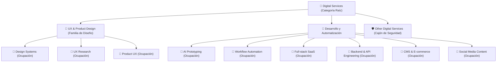
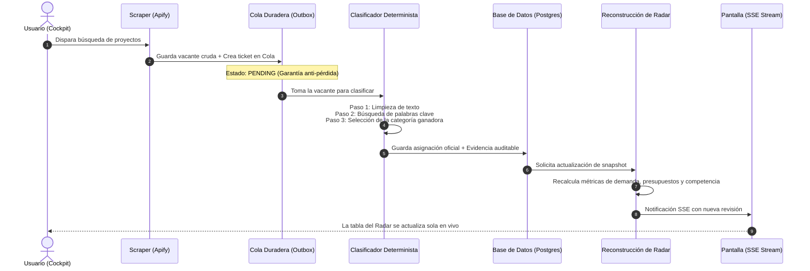

# Guía de Taxonomía y Generación de Categorías en el Radar de Mercado (Para Dummies)

> **Documentación Oficial de Producto y Operaciones**  
> **Espacio Confluence sugerido:** `Proposal Autopilot > Operaciones & Radar de Mercado > 02. Taxonomía y Clasificación de Vacantes`  
> **Etiquetas Confluence:** `proposal-autopilot`, `market-radar`, `taxonomia`, `clasificacion`, `para-dummies`, `workflow-guia`  
> **Código Fuente Principal:** [`backend/src/modules/scraping/services/market-taxonomy-classifier.service.ts`](file:///d:/SpotlightProjects/proposal-autopilot/backend/src/modules/scraping/services/market-taxonomy-classifier.service.ts)

---

## 1. ¿Qué es la Taxonomía y por qué existe? (La Metáfora del Almacén)

Imagina que todos los días llegan a tu puerta **500 cartas desordenadas** de clientes en Upwork buscando ayuda técnica. 
* Unos escriben: *"Need Figma wizard for mobile app"*.
* Otros escriben: *"Looking for someone to build a design system with tokens"*.
* Otros piden: *"Help with WordPress and WooCommerce store"*.

Si una persona tuviera que leer y etiquetar 500 cartas una por una a mano, perdería 4 horas al día. 
**La Taxonomía es el clasificador automático de cartas.** Es un sistema inteligente que lee cada vacante en una fracción de milisegundo y la coloca en el cajón exacto al que pertenece, para que cuando entres al **Radar de Mercado**, veas claramente en qué especialidades hay más dinero, más demanda y menos competencia.

---

## 2. La Estructura del Árbol de Cajones

Para que todo esté ordenado, no mezclamos conceptos al azar. El sistema organiza el mercado como un **árbol genealógico de dos niveles**:



* **Categoría (Nivel Padre):** Define la gran industria o área técnica (ejemplo: *UX & product design*).
* **Ocupación (Nivel Hijo / Hoja):** Es el nicho específico donde se presta el servicio (ejemplo: *Design systems* o *Backend & API engineering*).

---

## 3. El Catálogo Actual: ¿Cuáles son las categorías y qué buscan?

El sistema cuenta con **12 nodos oficiales** sembrados en la base de datos de producción:

| Cajón / Ocupación | ¿De qué se trata? | Palabras Clave Detonantes (`includeTerms`) |
| :--- | :--- | :--- |
| **Design systems** | Librerías de componentes, variables de Figma y tokens. | `design system`, `design tokens`, `component library`, `figma variables` |
| **UX research** | Pruebas de usabilidad, entrevistas de usuario, heurísticas. | `ux research`, `user research`, `usability testing`, `user interviews`, `heuristic evaluation` |
| **Product UX** | Diseño de productos digitales, UX/UI general. | `product ux`, `product designer`, `ux ui`, `ui ux`, `user experience` |
| **AI prototyping** | Agentes autónomos, LLMs, flujos con IA Generativa. | `ai prototyping`, `ai agent`, `agentic workflow`, `llm`, `generative ai` |
| **Workflow automation** | Automatización de procesos sin código o bajo código. | `workflow automation`, `n8n`, `zapier`, `make com`, `power automate` |
| **Full-stack SaaS** | Desarrollo de plataformas web completas y aplicaciones SaaS. | `full stack`, `saas`, `web application`, `software platform` |
| **Backend & API engineering** | Arquitectura de servidores, microservicios, bases de datos y APIs. | `backend`, `api`, `nestjs`, `graphql`, `microservice` |
| **CMS & e-commerce** | Tiendas online y gestores de contenido tradicionales. | `wordpress`, `shopify`, `webflow`, `ecommerce`, `e commerce` |
| **Social media content** | Creación de contenido y formatos de video corto. | `social media`, `content creation`, `instagram`, `tiktok`, `reels` |
| **Other digital services** | **El cajón de seguridad:** recibe todo lo que no encaja en las anteriores. | *No requiere palabras clave (se asigna automáticamente si no hay match).* |

---

## 4. El Viaje Paso a Paso de una Vacante (De Texto Crudo a Gráfica en Pantalla)

Cuando el botón *"Buscar Más Proyectos"* se presiona en la aplicación, ocurre una cadena de 6 pasos totalmente automatizados:



### Paso 1: Llegada del Trabajo Crudo
Apify extrae la vacante de Upwork y entrega tres datos esenciales:
* **Título:** *"Senior Figma Designer for SaaS Component Library"*
* **Descripción:** *"We need someone experienced with figma variables and design tokens..."*
* **Habilidades (Skills):** `["Figma", "Design Systems", "UI Design"]`

### Paso 2: La Limpieza Química del Texto (Normalización)
Para que el clasificador no se confunda con mayúsculas, tildes o signos de puntuación raros:
* Pasa todo a minúsculas (`senior figma designer...`).
* Reemplaza caracteres especiales (`!`, `@`, `#`, `$`, `/`) por espacios limpios.
* Remueve espacios dobles o saltos de línea basura.

### Paso 3: El Radar de Palabras Clave
El sistema compara el texto limpio contra la lista de `includeTerms` de cada categoría del catálogo:
* ¿Encontró *"figma variables"*? **Sí** (en descripción).
* ¿Encontró *"design tokens"*? **Sí** (en descripción).
* ¿Encontró *"component library"*? **Sí** (en título y descripción).
* ¿Encontró *"design system"*? **Sí** (en skills).

### Paso 4: La Coronación de la Categoría Ganadora y la Red de Seguridad
* **La Regla del Ganador:** La categoría con **más términos encontrados** y **más campos coincidentes** (título + descripción + skills) gana la asignación. En nuestro ejemplo: **`Design systems`** gana con un puntaje de confianza del **95%**.
* **¿Y si no coincide ninguna palabra clave?**  
  ¡Jamás se descarta ni se pierde el trabajo! Se activa automáticamente la regla de **Fallback Seguro**: el trabajo se envía a **`Other digital services`** (`other-services`) con una confianza de `0.1` y una nota explícita que dice: `fallbackReason: 'no-rule-match'`.

### Paso 5: La Cola de Trabajo Duradera (Outbox Pattern)
Para evitar que la aplicación se congele mientras analiza decenas de empleos a la vez:
1. El empleo se guarda en la base de datos junto con una orden de trabajo pendiente en la tabla `taxonomy_classification_work`.
2. Un trabajador en segundo plano toma las órdenes una por una.
3. **Seguridad contra caídas:** Si el servidor se apaga o se reinicia en medio del proceso, al volver a encenderse lee la tabla y retoma los empleos pendientes sin perder ninguno.

### Paso 6: El Radar de Mercado y las Revisiones Inmutables
Una vez que todos los empleos del lote están clasificados:
1. El motor del Radar agrupa los números: calcula cuántos empleos hay en cada categoría en los últimos 7 y 30 días, el presupuesto promedio y cuántas propuestas tienen.
2. Guarda una **Revisión Inmutable** (ejemplo: Revisión #4) para que la historia nunca se distorsione.
3. Envía una señal instantánea a la pantalla del usuario (Server-Sent Events) y las gráficas del Cockpit se actualizan automáticamente.

---

## 5. Ejemplo Real de Evidencia Auditable

Cada clasificación que se guarda en la base de datos almacena una "caja negra" con la evidencia exacta de por qué se tomó la decisión. Puedes verla en la tabla `job_category_assignments`:

```json
{
  "taxonomyNodeSlug": "design-systems",
  "taxonomyVersion": 1,
  "confidence": 0.95,
  "evidence": {
    "matchedTerms": [
      "component library",
      "design tokens",
      "figma variables",
      "design system"
    ],
    "matchedFields": [
      "title",
      "description",
      "skills"
    ]
  }
}
```

---

## 6. Preguntas Frecuentes (FAQ) para Dummies

#### ¿Por qué no usamos ChatGPT o Claude para clasificar cada vacante?
1. **Velocidad:** El clasificador determinista tarda **menos de 1 milisegundo** por empleo. Un LLM tardaría entre 1.5 y 3 segundos por empleo.
2. **Costo Cero:** Clasificar 10,000 vacantes al mes con este motor cuesta **\$0 dólares**. Con un LLM costaría cientos de dólares en tokens.
3. **Consistencia 100%:** Las reglas matemáticas no tienen "alucinaciones" ni cambian de opinión según el día.

#### ¿Cómo agregamos una nueva categoría al sistema?
No se requiere programar código nuevo en el backend. Solo se debe registrar un nuevo registro en la tabla `market_taxonomy_nodes` con el nombre de la categoría y sus palabras detonantes (`includeTerms`). El motor de clasificación lo leerá y comenzará a clasificar empleos en esa categoría de inmediato.

