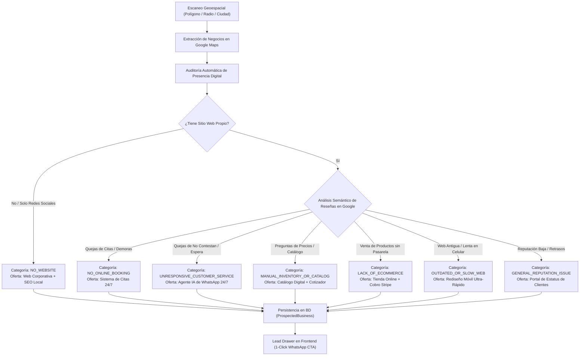
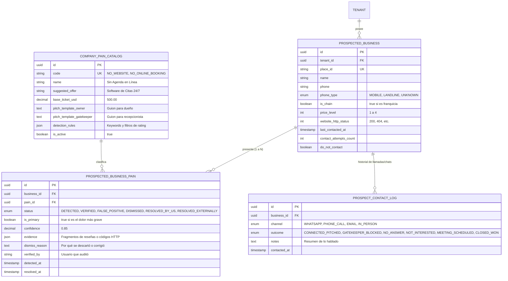

# Geo-Radar Prospector: Matriz de Dolencias de Negocios en Google Maps y Catálogo de Ofertas de Software

> **Documentación Oficial de Arquitectura y Estrategia de Ventas**  
> **Espacio Confluence sugerido:** `Proposal Autopilot > Prospección B2B & Geo-Radar > 03. Matriz de Dolencias y Ofertas de Google Search/Maps`  
> **Etiquetas Confluence:** `proposal-autopilot`, `geo-radar`, `prospecting`, `google-maps`, `pain-matrix`, `b2b-sales`, `lead-generation`, `whatsapp-automation`  
> **Código Fuente Principal:**  
> - Backend: [`backend/src/modules/prospecting/services/company-pain-analyzer.service.ts`](file:///d:/SpotlightProjects/proposal-autopilot/backend/src/modules/prospecting/services/company-pain-analyzer.service.ts)  
> - Backend: [`backend/src/modules/prospecting/prospecting.service.ts`](file:///d:/SpotlightProjects/proposal-autopilot/backend/src/modules/prospecting/prospecting.service.ts)  
> - Frontend: [`frontend/src/app/features/radar/geo-radar.component.ts`](file:///d:/SpotlightProjects/proposal-autopilot/frontend/src/app/features/radar/geo-radar.component.ts)  
> - Modelo de Datos: [`backend/prisma/schema.prisma`](file:///d:/SpotlightProjects/proposal-autopilot/backend/prisma/schema.prisma#L280-L330) (`CompanyPainCategory`, `ProspectedBusiness`)

---

## 1. Resumen Ejecutivo (¿Qué es el Geo-Radar y la Matriz de Dolencias?)

El módulo de **Geo-Radar & B2B Prospecting** permite a una agencia o consultor técnico escanear comercios y empresas locales mediante polígonos geoespaciales o radios de búsqueda sobre Google Maps / Google Search (ej. clínicas dentales, restaurantes, inmobiliarias, distribuidores mayoristas, talleres o despachos legales en ciudades como Mérida, Querétaro, Bogotá, Medellín, San Francisco o Austin).

### El Principio de "Venta Basada en Auditoría" (No Vender Humo)
En lugar de hacer llamadas en frío genéricas (*"ofrezco páginas web"*), el sistema audita automáticamente la presencia pública del negocio en Google y detecta su **dolor crítico no resuelto** (*Primary Pain*):
1. **¿Tiene sitio web oficial propio?** (o solo un link a Facebook/Instagram).
2. **¿De qué se quejan sus clientes en las reseñas de Google Maps?** (atención lenta en WhatsApp, llamadas no contestadas, citas empalmadas, falta de precios o catálogos).
3. **¿Cuál es la solución de software llave en mano que elimina esa queja de raíz?**

Con base en este análisis, el sistema genera automáticamente un **borrador de pitch personalizado para WhatsApp** listo para enviar en 1 clic.

---

## 2. Diagrama de Flujo del Pipeline de Prospección



---

## 3. Matriz Maestra de Dolencias, Ofertas y Tickets Comerciales

Esta es la taxonomía oficial implementada en el enum `CompanyPainCategory` de Prisma:

| Categoría Enum | Señal Detectada en Google Maps / Search | Solución de Software a Vender | Propuesta de Valor para el Negocio | Ticket Sugerido (USD) |
| :--- | :--- | :--- | :--- | :---: |
| **`NO_WEBSITE`** | Ficha con rating positivo (>4.0⭐) pero el campo `website` está vacío o enlaza a Facebook/Instagram. | **Sitio Web Corporativo de Alta Velocidad + SEO Local** | El 75% de los clientes verifican una web antes de acudir. Otorga presencia institucional, captura tráfico orgánico y genera credibilidad. | **\$300 – \$800**<br>*(pago único)* |
| **`OUTDATED_OR_SLOW_WEB`** | Sitio existente que tarda >4s en cargar, no se adapta a pantallas móviles, carece de SSL (HTTP) o usa un tema desactualizado. | **Rediseño Web Moderno y Ultra-Rápido (Next.js / Tailwind)** | Carga en <1 segundo en dispositivos móviles, reduce tasa de rebote al 0% y duplica conversiones directas a llamadas. | **\$500 – \$1,200**<br>*(pago único)* |
| **`NO_ONLINE_BOOKING`** | Reseñas con palabras clave: *"cita"*, *"agendar"*, *"turno"*, *"espera"*, *"horario"*, *"cancelaron"*. | **Plataforma de Agendamiento Online 24/7 + Sincronización Calendario** | El paciente/cliente agenda solo en 30 segundos. Recordatorios automáticos por SMS/WhatsApp reducen el ausentismo (no-shows) en 40%. | **\$400 – \$900** setup<br>+ **\$30 – \$50/mes** |
| **`UNRESPONSIVE_CUSTOMER_SERVICE`** | Reseñas con quejas explícitas: *"no contestan el teléfono"*, *"mandé WhatsApp y no responden"*, *"pésima atención al cliente"*. | **Agente de IA para WhatsApp 24/7 (LangGraph / Gemini / n8n)** | Respuestas inmediatas en <5 segundos a dudas frecuentes, ubicación, cotizaciones y horarios, los 7 días de la semana. | **\$500 – \$1,500** setup<br>+ **\$50 – \$100/mes** |
| **`MANUAL_INVENTORY_OR_CATALOG`** | Clientes preguntando frecuentemente por stock, modelos o precios, obligando al negocio a enviar fotos o PDFs pesados por chat. | **Catálogo Digital Interactivo con Cotizador Automático** | El cliente consulta disponibilidad, arma su pedido con cálculo automático y lo envía directo a WhatsApp listo para facturar. | **\$400 – \$1,000**<br>*(pago único)* |
| **`LACK_OF_ECOMMERCE`** | Negocio que comercializa productos pero exige transferencias bancarias manuales y envío de comprobante de pago por WhatsApp. | **Tienda Online / Pasarela de Pagos en 1 Clic (Stripe / Mercado Pago)** | Cobro inmediato con tarjeta de débito/crédito, confirmación automática de orden y eliminación de validaciones bancarias manuales. | **\$600 – \$1,800**<br>*(pago único)* |
| **`GENERAL_REPUTATION_ISSUE`** | Calificación comprometida (<4.0⭐) por falta de información sobre tiempos de entrega o estado de órdenes/servicios. | **Portal de Clientes / Rastreo en Línea + Filtro Preventivo de Reseñas** | Los clientes consultan el estado de su orden en tiempo real; encuestas privadas interceptan la insatisfacción antes de llegar a Google. | **\$700 – \$2,000** setup<br>+ **\$50/mes** |

---

## 4. Guiones Tácticos de Prospección (Scripts de WhatsApp)

El motor (`CompanyPainAnalyzerService`) pre-redacta el mensaje adaptado a los datos de la ficha. Ejemplos de los guiones generados:

### Caso 1: Sin Sitio Web (`NO_WEBSITE`)
> *"Hola, equipo de **{{name}}**. Noté que en **{{city}}** tienen excelente reputación (**{{rating}}⭐ con {{reviewsCount}} reseñas** en Google Maps), pero aún no cuentan con un sitio web oficial propio. Hoy en día el 75% de los clientes verifican una página antes de acudir. Desarrollamos sitios web modernos que se posicionan en los primeros lugares de Google y convierten visitantes en clientes directos. ¿Les gustaría ver una propuesta visual sin compromiso?"*

### Caso 2: Citas y Agendamiento (`NO_ONLINE_BOOKING`)
> *"Hola **{{name}}**. Estuve revisando sus comentarios en Google en **{{city}}** y felicidades por el servicio que ofrecen. Noté que algunos usuarios comentan demoras al agendar o confirmar citas por teléfono. Desarrollamos una solución ligera de agenda en línea donde sus clientes reservan en 30 segundos y reciben recordatorios automáticos por WhatsApp, reduciendo inasistencias en un 40%. ¿Les gustaría ver una demo de 2 minutos?"*

### Caso 3: Atención y WhatsApp Desatendido (`UNRESPONSIVE_CUSTOMER_SERVICE`)
> *"Hola **{{name}}**. Vi sus reseñas en Google en **{{city}}**. Muchos clientes buscan información fuera de horario de oficina y comentan que a veces es difícil comunicarse rápido. Implementamos agentes de Inteligencia Artificial para WhatsApp que responden dudas de servicios, precios y horarios en menos de 5 segundos, los 7 días de la semana. ¿Les interesaría probar un demo con el nombre de su negocio?"*

### Caso 4: Catálogo y Cotizaciones Lentas (`MANUAL_INVENTORY_OR_CATALOG`)
> *"Hola **{{name}}**. Encontramos su negocio en Google Maps en **{{city}}**. Notamos una gran oportunidad para agilizar cómo sus clientes consultan sus productos y precios. Diseñamos catálogos digitales interactivos que permiten cotizar al instante y recibir los pedidos detallados directamente en su WhatsApp. ¿Tienen 5 minutos esta semana para mostrarles un ejemplo para su sector?"*

---

## 5. Implementación en Código y Arquitectura

### 5.1 Esquema Relacional en PostgreSQL (Prisma DDL)
```prisma
enum CompanyPainCategory {
  NO_WEBSITE
  OUTDATED_OR_SLOW_WEB
  NO_ONLINE_BOOKING
  UNRESPONSIVE_CUSTOMER_SERVICE
  MANUAL_INVENTORY_OR_CATALOG
  LACK_OF_ECOMMERCE
  GENERAL_REPUTATION_ISSUE
}

enum ProspectedLeadStatus {
  DISCOVERED
  AUDITED
  CONTACTED
  DISQUALIFIED
}

model ProspectedBusiness {
  id              String               @id @default(uuid()) @db.Uuid
  tenantId        String               @map("tenant_id") @db.Uuid
  placeId         String?              @map("place_id") @db.VarChar(255)
  name            String               @db.VarChar(255)
  category        String?              @db.VarChar(150)
  address         String?              @db.Text
  city            String?              @db.VarChar(100)
  state           String?              @db.VarChar(100)
  country         String?              @default("Mexico") @db.VarChar(100)
  latitude        Decimal?             @db.Decimal(10, 7)
  longitude       Decimal?             @db.Decimal(10, 7)
  websiteUrl      String?              @map("website_url") @db.Text
  phone           String?              @db.VarChar(50)
  rating          Decimal?             @db.Decimal(3, 2)
  reviewsCount    Int?                 @default(0) @map("reviews_count")
  status          ProspectedLeadStatus @default(DISCOVERED)
  primaryPain     CompanyPainCategory? @map("primary_pain")
  painConfidence  Decimal?             @default(0.50) @map("pain_confidence") @db.Decimal(3, 2)
  painAnalysis    Json?                @map("pain_analysis")
  suggestedOffer  String?              @map("suggested_offer") @db.Text
  salesPitchDraft String?              @map("sales_pitch_draft") @db.Text
  rawGoogleData   Json?                @map("raw_google_data")
  scannedAt       DateTime             @default(now()) @map("scanned_at")

  tenant Tenant @relation(fields: [tenantId], references: [id], onDelete: Cascade)

  @@unique([tenantId, placeId], name: "uq_tenant_place")
  @@index([tenantId, city, category])
  @@map("prospected_businesses")
}
```

### 5.2 Heurísticas del Motor Analizador (`CompanyPainAnalyzerService`)
El archivo [`company-pain-analyzer.service.ts`](file:///d:/SpotlightProjects/proposal-autopilot/backend/src/modules/prospecting/services/company-pain-analyzer.service.ts) implementa la lógica determinista para clasificar el dolor:
1. **Regla de URL Web:** Si `websiteUrl` es nulo o coincide con dominios de redes sociales (`facebook.com`, `instagram.com`), se categoriza como `NO_WEBSITE` con confianza 0.95.
2. **Minería de Reseñas (Booking):** Evalúa tokens `['cita', 'agendar', 'turno', 'espera', 'cancelaron']`. Si coinciden $\ge 2$ o el rating es $<4.2$, asigna `NO_ONLINE_BOOKING`.
3. **Minería de Reseñas (Soporte y WhatsApp):** Evalúa tokens `['no contestan', 'no responden', 'nadie contesta', 'tardan', 'whatsapp']`. Asigna `UNRESPONSIVE_CUSTOMER_SERVICE`.
4. **Minería de Reseñas (Catálogo):** Evalúa tokens `['precio', 'costo', 'cotizar', 'catálogo', 'inventario']`. Asigna `MANUAL_INVENTORY_OR_CATALOG`.
5. **Fallback:** Si cuenta con web pero no hay quejas graves, asigna `OUTDATED_OR_SLOW_WEB` con propuesta de optimización móvil.

---

## 6. Integración en Frontend (Experiencia de Usuario)

En el módulo [`geo-radar.component.ts`](file:///d:/SpotlightProjects/proposal-autopilot/frontend/src/app/features/radar/geo-radar.component.ts):
* **Pines Visuales Semánticos:** Los marcadores en el mapa Leaflet cambian de color según la urgencia del dolor (Rojo: Oportunidad Crítica por falta de web o quejas severas).
* **Filtros por Dolor:** La barra lateral permite filtrar instantáneamente: *"Ver solo sin página web"* o *"Ver solo con problemas de atención"*.
* **1-Click WhatsApp CTA:** El botón del drawer construye la URL:
  ```
  https://wa.me/{cleanPhone}?text={encodeURIComponent(salesPitchDraft)}
  ```
  Permitiendo que el consultor o vendedor abra WhatsApp Web / WhatsApp Mobile con el mensaje exacto redactado en menos de 1 segundo.

---

## 7. Edge Cases Enterprise en Prospección B2B y Análisis de Riesgo

Al escalar la prospección comercial al mundo real, un scraper ingenuo de Google Maps tropieza con escenarios que desperdician horas de trabajo o queman números de WhatsApp por spam. A continuación se detallan los 7 edge cases críticos identificados y su mecanismo de defensa:

### 7.1 La Paradoja de la Franquicia / Gran Cadena (Multi-branch / Parent-Child)
* **Escenario:** El radar escanea un "Starbucks Calle 60", "OXXO Plaza Mayor", "Farmacias Similares" o "Clínicas Salud Digna".
* **El Problema:** El encargado de sucursal local no tiene presupuesto ni atribución para contratar una web o un bot de software (\$500 – \$1,500 USD). La decisión se toma en corporativos centrales en CDMX o Monterrey.
* **Impacto en BD y Detección:**
  - Campo `is_chain: Boolean` y `brand_parent_id: String?`.
  - Detección determinista por marcas conocidas (lista negra corporativa) o coincidencia por nombre exacto en múltiples puntos de la ciudad/estado ($\ge 3$ sucursales con la misma razón comercial $\to$ etiquetado como `CHAIN_BRANCH`).
  - **Acción:** Excluir por defecto de la prospección fría o marcar con alerta *"Requiere contacto con Corporativo / C-Level"*.

### 7.2 Deduplicación Temporal, Enfriamiento y Anti-Spam (Cooldown Policy)
* **Escenario:** Varios miembros del equipo escanean el mismo polígono, o se repite el escaneo en la misma ciudad semana tras semana.
* **El Problema:** Escribirle al mismo dueño 3 veces en 10 días desde números distintos quema la marca de la agencia y provoca reportes de spam que bloquean la cuenta de WhatsApp Business.
* **Impacto en BD:**
  - `last_contacted_at: DateTime?`
  - `contact_attempts_count: Int @default(0)`
  - `do_not_contact: Boolean @default(false)` (Blacklist de bajas voluntarias).
  - `contact_cooldown_days: Int @default(30)` (Periodo de gracia obligatorio de 30 a 60 días antes de poder re-contactar).

### 7.3 Negocios Fantasma (Permanently / Temporarily Closed)
* **Escenario:** Fichas de negocios en Google Maps que cerraron definitivamente o pausaron operaciones pero conservan su ficha activa.
* **El Problema:** Generar pitches y gastar tiempo contactando teléfonos desconectados o negocios quebrados.
* **Impacto en BD:**
  - Validación de `business_status === 'OPERATIONAL'`.
  - Regla de Actividad Reciente: Si la fecha de la última reseña es $> 18$ meses atrás y carece de publicaciones recientes en Google Business, se marca con `status = STALE_OR_INACTIVE`.

### 7.4 Validación de Teléfono: Fijo vs Celular WhatsApp (Landline vs Mobile)
* **Escenario:** En América Latina, hasta el 40% de los comercios registran un conmutador de línea fija (`+52 999 920...`) en Google Maps.
* **El Problema:** El botón `wa.me/` falla o abre WhatsApp indicando: *"El número no está registrado en WhatsApp"*, frustrando al vendedor.
* **Impacto en BD y Dominio:**
  - `phone_type: Enum ('MOBILE' | 'LANDLINE' | 'VOIP' | 'UNKNOWN')`.
  - Validación mediante longitud y prefijos móviles locales o validación ligera en background.
  - **Acción en UI:** Si es `LANDLINE`, el botón primario cambia automáticamente a **"Llamada Telefónica / Cold Call"** con guion de llamada, ocultando el botón de WhatsApp.

### 7.5 El "Gatekeeper" de WhatsApp (Recepcionista vs Decisor / Dueño)
* **Escenario:** El WhatsApp registrado suele estar en manos de la recepcionista, asistente o despachador, cuyo trabajo es agendar citas o contestar precios, no comprar software.
* **El Problema:** Un mensaje directo de *"Te vendo un desarrollo de software de \$1,000 USD"* es ignorado o bloqueado de inmediato.
* **Estrategia Dual de Mensajería (`pitch_tone`):**
  - **Tono Gatekeeper (Exploratorio):** *"Hola buen día, disculpa la molestia. Quería consultar con quién de la gerencia o administración de {{name}} podría compartir una auditoría breve sobre su presencia digital..."*
  - **Tono Dueño / Decisor (Directo):** *"Hola {{name}}, noto que tienen 4.5⭐ pero sus clientes se quejan de esperas al agendar. Desarrollamos una agenda 24/7..."*

### 7.6 Enlaces Web Caídos o Dominios Expirados (Broken Links / 404 / Parking)
* **Escenario:** El negocio tiene un campo `website` registrado, pero el dominio expiró, devuelve error `404 Not Found`, `DNS_PROBE_FINISHED_NXDOMAIN` o está aparcado en GoDaddy.
* **Oportunidad Comercial:** Un dominio caído o secuestrado es el dolor más crítico y vendible que existe.
* **Impacto en BD:**
  - Micro-verificación HTTP HEAD: `website_http_status: Int?` (200, 404, 500, EXPIRED).
  - Si el dominio está caído, el dolor se reclasifica automáticamente a **`WEBSITE_DOWN_OR_EXPIRED`** con confianza 0.99 y un pitch de urgencia de alta conversión.

### 7.7 Nivel de Precio y Sensibilidad al Ticket (`price_level`)
* **Escenario:** Google Maps etiqueta los negocios con `price_level` (`$` bajo, `$$` medio, `$$$` premium).
* **El Problema:** Ofrecer una web de \$1,500 USD a una panadería barrial (`$`) es invendible; ofrecer una solución de \$200 USD a un hospital privado o despacho de arbitraje (`$$$`) genera desconfianza por baja calidad percibida.
* **Mitigación:** El ticket sugerido se calcula dinámicamente multiplicando el valor base de la dolencia por el multiplicador del `price_level`.

---

## 8. Arquitectura Relacional M:N y Modelo de Ciclo de Vida de Dolencias

Para resolver la multiplicidad de dolencias en un mismo negocio y permitir corregir falsos positivos o registrar soluciones vendidas, el modelo se desacopla en tres entidades:



---

## 9. Plan de Implementación y Mitigación Operativa

| Fase | Tarea Técnica / Operativa | Módulo Afectado | Entregable / Validación |
| :---: | :--- | :--- | :--- |
| **Fase 1: Schema & Migración** | Crear modelos `CompanyPainCatalog`, `ProspectedBusinessPain`, `ProspectContactLog` y extender `ProspectedBusiness`. | `backend/prisma/schema.prisma` | Migración limpia en PostgreSQL sin pérdida de datos. |
| **Fase 2: Catálogo y Seeder** | Sembrar las 7 dolencias base con precios, tickets sugeridos, templates para Gatekeeper y Dueño, y reglas de tokens. | `backend/prisma/seed-pains.ts` | Endpoint `GET /api/prospecting/pains` respondiendo catálogo dinámico. |
| **Fase 3: Motor Analizador Multi-Dolor** | Refactorizar `CompanyPainAnalyzerService` para retornar un array de dolencias ordenadas por severidad en lugar de 1 solo enum. | `backend/.../company-pain-analyzer.service.ts` | Pruebas unitarias de detección simultánea (Web lenta + Sin citas). |
| **Fase 4: Guardas y Filtros Anti-Spam** | Implementar validación de número móvil vs fijo, exclusión de cadenas y cooldown de 30 días en el backend. | `backend/.../prospecting.service.ts` | Bloqueo automático de re-contacto a prospectos en periodo de enfriamiento. |
| **Fase 5: UI Lead Drawer & Contact Log** | Integrar en el frontend selector de dolencias, botón de descarte (*"Falso positivo"*) y modal para registrar el resultado de la llamada o WhatsApp. | `frontend/.../geo-radar.component.ts` | Registro con 1 clic del resultado del contacto (`CONNECTED`, `MEETING_SCHEDULED`, etc.). |
