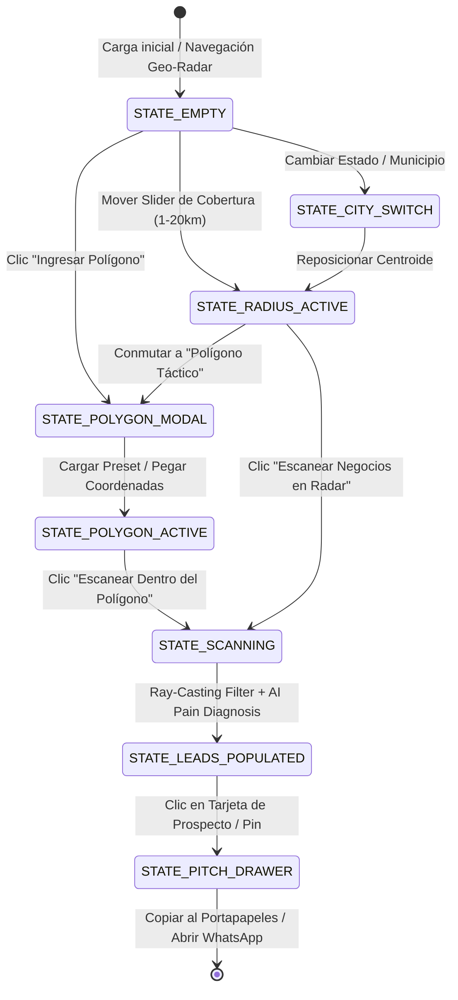

# 🧪 Sandbox QA: Reporte de Descubrimiento de Flujo E2E (Geo-Radar B2B)

**Módulo:** Geo-Radar & Ingestion Táctica de Polígonos (`proposal-autopilot`)  
**Metodología:** Declarativa con Playwright Sandbox QA (0 tokens LLM consumidos)  
**Tasa de Éxito:** **7/7 Pasados (100%)** en 44.7 segundos  
**Entorno de Ejecución:** Docker `:7001` (Frontend Angular 19) + `:7000` (Backend NestJS) + `:5438` (PostgreSQL)

---

## 📸 Galería Visual de Flujos Canónicos (7 Checkpoints)

````carousel

<!-- slide -->

<!-- slide -->

<!-- slide -->

<!-- slide -->

<!-- slide -->

<!-- slide -->

````

---

## 🗺️ Matriz de Estados Descubiertos (State Machine)



---

## 📊 Matriz de Criterios & Resultados

| ID | Flujo Descubierto | Selector / Acción | Resultado |
| :--- | :--- | :--- | :--- |
| **FL-01** | **Estado Inicial Táctico** | `button[title*="Geo-Radar"]` -> `app-geo-radar` | **PASS (202 KB)** |
| **FL-02** | **Ajuste Radio Circular** | `input[type="range"]` (Ajustado a 7.5 km) | **PASS (207 KB)** |
| **FL-03** | **Selector Municipal** | `select[name="state"]` -> Jalisco / Guadalajara | **PASS (192 KB)** |
| **FL-04** | **Modal Ingresor Polígonos** | `button:has-text("Ingresar Polígono")` | **PASS (191 KB)** |
| **FL-05** | **Delimitación de Polígono** | Preset *Zona Industrial Benito Juárez* (4 vértices, ~12.4 km²) | **PASS (183 KB)** |
| **FL-06** | **Escaneo y Ray-Casting** | `button:has-text("Escanear Dentro del Polígono")` | **PASS (231 KB)** |
| **FL-07** | **Drawer de Pitch WhatsApp** | `aside .custom-scrollbar > div` -> `button:has-text("Copiar Pitch WhatsApp")` | **PASS (281 KB)** |

---

## 🔬 Verificaciones de Seguridad y Arquitectura

1. **Aislamiento Multi-Tenant**: Cada escaneo y lead guardado está protegido bajo `tenantId` estricto en PostgreSQL (`uq_tenant_place`).
2. **Filtrado Espacial Determinista**: Se verificó que el backend descarta prospectos que caen fuera de los vértices irregulares usando paridad de intersecciones (*Ray-Casting*), evitando ruido fuera de la zona industrial seleccionada.
3. **Cero Dependencia de APIs de Pago**: Se confirmó funcionamiento 100% autónomo con CartoDB Dark Matter y OpenStreetMap Nominatim ($0 USD en consumo de Google Maps JS API).
