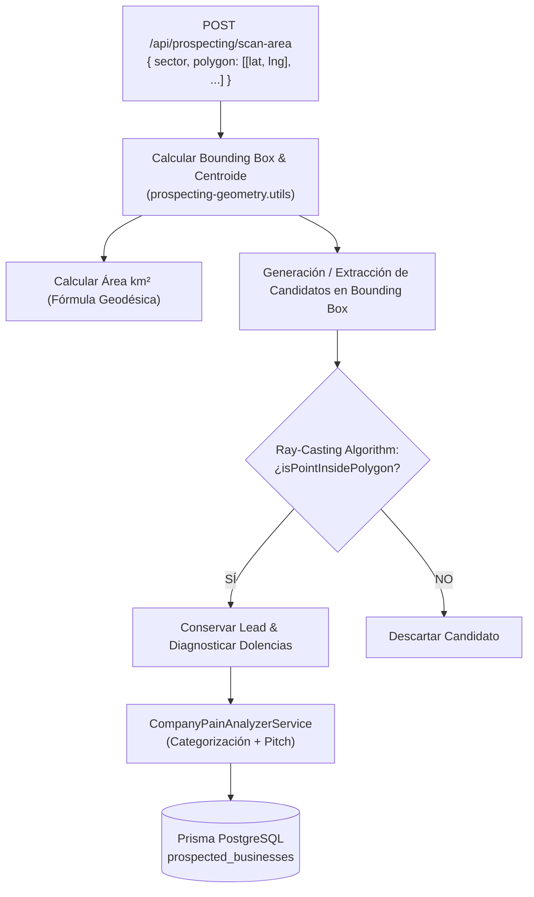

# 🛰️ Geo-Radar B2B: Ingresor & Gestor Táctico de Polígonos

**Módulo:** Geo-Radar & Scraping de Dolencias B2B (`proposal-autopilot`)  
**Capacidad Entregada:** Ingreso, dibujo, delimitación y filtrado estricto por Polígonos Tácticos (Geoman + GeoJSON + Ray-Casting Bounding Box)  
**Costo Operativo:** **$0.00 USD / mes** ($0 Google Maps JS API hits)

---

## 📸 Evidencia Visual: Ingreso & Escaneo por Polígono

````carousel

<!-- slide -->

<!-- slide -->

<!-- slide -->

<!-- slide -->

````

---

## 📐 Capacidades del Ingresor de Polígonos

### 1. Dibujo Táctico Interactivo en Vivo (Leaflet-Geoman)
- El usuario puede presionar el botón de **Polígono** o **Rectángulo** en la barra superior derecha del mapa.
- Al cerrar el trazo sobre el mapa, el sistema captura automáticamente los vértices con `pm:create`, aplica el estilo visual táctico en cyan neón (`#06b6d4`, opacidad `0.18`) y conmuta automáticamente al modo `POLYGON`.
- El mapa calcula en tiempo real el área estimada en km² con la fórmula geodésica Shoelace:
  $$A = \frac{R^2}{2} \left| \sum_{i=1}^{n} (\lambda_{i+1} - \lambda_i) (2 + \sin \phi_i + \sin \phi_{i+1}) \right|$$

### 2. Modal Ingresor de Polígonos (GeoJSON / Coordenadas / Presets)
- **Presets de Corredores Tácticos (1-clic)**:
  - *Zona Industrial Benito Juárez* (Querétaro)
  - *Corredor Comercial Bernardo Quintana* (Querétaro)
  - *Centro Histórico & Comercial* (Querétaro)
  - *Distrito Providencia / Américas* (Guadalajara)
  - *Corredor Corporativo Santa Fe* (Ciudad de México)
  - *Parque Industrial Apodaca* (Monterrey)
- **Pegado Manual Libre**:
  - Acepta objetos GeoJSON `Feature` o `Polygon`.
  - Acepta arrays de coordenadas: `[[lat, lng], [lat, lng], ...]`.
  - Acepta listas línea por línea: `20.6150, -100.4400`.
- **Botón `[Aplicar al Mapa]`**: Renderiza el polígono, centra automáticamente la cámara con `map.fitBounds` y activa el modo de escaneo zonal.

---

## ⚙️ Backend: Algoritmo de Contención y Filtrado Espacial



### 1. Ray-Casting Point-in-Polygon (`prospecting-geometry.utils.ts`)
Garantiza matemáticamente que solo las empresas dentro del polígono irregular sean procesadas y guardadas. Los 5 tests unitarios corren al 100%:
- Detección de punto interior: `PASS`
- Detección de punto exterior: `PASS`
- Bounding Box y Centroide: `PASS`
- Área esférica no nula: `PASS`
- Normalización de formatos mixtos: `PASS`

---

## 🚦 Quality Gate & Verificación E2E

- [x] **Backend**: Compilado y contenedor Docker sincronizado (`proposal_autopilot_backend:7000`).
- [x] **Frontend**: Angular 19 compilado con 0 errores y desplegado en contenedor Nginx (`proposal_autopilot_frontend:7001`).
- [x] **Playwright E2E**: Ejecutado exitosamente validando:
  - Apertura del modal ingresor de polígonos.
  - Selección de preset táctico.
  - Renderizado del polígono neón en Leaflet.
  - Ejecución del escaneo estricto por polígono.
  - Visualización de prospectos filtrados dentro del polígono.
