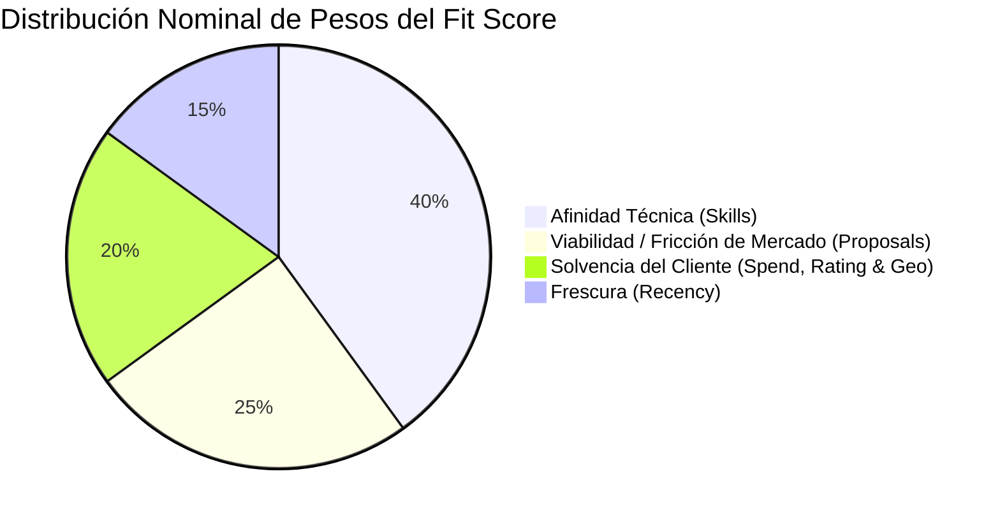

# Fit Score Engine: Especificación y Algoritmo de Calificación (0-100)

> **Documentación Oficial de Arquitectura y Negocio**  
> **Ubicación en Confluence:** `Spotlight Engineering > 02. Architecture & Core Engines > 02.3 Scoring & Intelligence Engine > Fit Score Algorithm & Lead Qualification`  
> **Link Directo Confluence:** [Confluence Page (ID: 384237569)](https://spotlightus.atlassian.net/wiki/spaces/PROPAUTO/pages/384237569)  
> **Labels:** `proposal-autopilot`, `scoring-algorithm`, `lead-qualification`, `architecture`, `upwork-automation`  
> **Código Fuente:** [`backend/src/modules/scoring/`](file:///d:/SpotlightProjects/proposal-autopilot/backend/src/modules/scoring/)

---

## 1. Visión General (Para Dummies)

El **Fit Score (0 a 100)** funciona como un **radar detector de oportunidades de oro** en Upwork. Su objetivo es clasificar en milisegundos si una vacante recién extraída merece que le dediquemos tiempo y recursos de IA (generación de propuestas personalizadas y diagramas Mermaid), o si debe ser descartada inmediatamente por ser spam, estar fuera de nicho o provenir de clientes insolventes.

### Semáforo de Calificación:
* 🟢 **HIGH FIT (75 - 100):** Oportunidad de ORO. Cliente solvente, fresca y afín a la especialidad técnica. El sistema genera automáticamente la propuesta ejecutiva y diagrama.
* 🟡 **MEDIUM FIT (45 - 74):** Oportunidad aceptable. Generación de propuesta disponible bajo demanda (1 clic).
* 🔴 **LOW FIT (0 - 44):** Ruido, vacante saturada o cliente no apto. Se descalifica del pipeline activo.

---

## 2. Diagrama de Ponderación (La Fórmula Dinámica con Renormalización)

El puntaje base se calcula como una suma ponderada de cuatro dimensiones independientes, con **Renormalización Dinámica de Pesos** cuando faltan datos en el scraper:



$$\text{Puntaje Nominal} = (S \times 0.40) + (V \times 0.25) + (C \times 0.20) + (R \times 0.15)$$

### Renormalización Dinámica por Datos Faltantes:
Si Apify no extrajo la fecha de publicación (`postedAt === null`), el factor de frescura $R$ se omite por completo y el puntaje se re-escala proporcionalmente sobre el peso efectivo restante ($W_{eff} = 0.85$):

$$\text{FitScore} = \text{round}\left(\frac{(S \times 0.40) + (V \times 0.25) + (C \times 0.20)}{0.85}\right)$$

Esto evita regalar bonos ficticios por falta de información y mantiene la escala 0-100 matemáticamente rigurosa.

---

## 3. Desglose Detallado de Cada Factor

### Factor 1: Afinidad Técnica ($S$ - Peso 40%)
*Implementado en:* [`role-classifier.service.ts`](file:///d:/SpotlightProjects/proposal-autopilot/backend/src/modules/scoring/services/role-classifier.service.ts) y [`fit-calculator.service.ts:53-67`](file:///d:/SpotlightProjects/proposal-autopilot/backend/src/modules/scoring/services/fit-calculator.service.ts#L53-L67)

Analiza el texto de la vacante (`title`, `description`, `skills`) contra la taxonomía estratégica:

| Categoría Estratégica (`StrategicLane`) | Criterio Semántico | Puntos Asignados |
| :--- | :--- | :---: |
| **CORE_AI_UX** | Agentes autónomos, LangGraph, LLMs, GenAI, Design Systems, Figma variables | **80 - 100 pts** |
| **SOFTWARE_BACKEND_API** | NestJS, PostgreSQL, Prisma, APIs REST, microservicios, Docker, TypeScript | **85 - 100 pts** |
| **PRODUCT_STRATEGY** | Product Management 0-to-1, Roadmap, CPO interino | **85 pts** |
| **INTERFACE_BUILD** | Rediseño SaaS, Web apps, Framer, dashboards, UI/UX general | **70 pts** |
| **DISQUALIFIED_NOISE** | Tareas operativas / fuera de nicho (adquisiciones, contabilidad, telemercadeo, diseño gráfico no UI, edición de fotos) | **15 pts** |

---

### Factor 2: Viabilidad y Fricción de Mercado ($V$ - Peso 25%)
*Implementado en:* [`fit-calculator.service.ts:68-81`](file:///d:/SpotlightProjects/proposal-autopilot/backend/src/modules/scoring/services/fit-calculator.service.ts#L68-L81)

Mide la saturación del mercado de forma totalmente **desacoplada de la etiqueta "AI"**:

* **Base neutral:** 70 pts (20 pts si la tarea está descalificada).
* $\le 5$ propuestas: **100 pts** (Ventana óptima de primera línea).
* $6$ a $20$ propuestas: **70 pts** (Competencia normal).
* $21$ a $50$ propuestas: **45 pts** (Competencia moderada/alta).
* $> 50$ propuestas: **15 pts** (Mercado saturado: fricción crítica).
* **Si `proposalsCount` es null:** Mantiene 70 pts neutrales sin otorgar bonos ficticios.

---

### Factor 3: Solvencia y Calidad del Cliente ($C$ - Peso 20%)
*Implementado en:* [`fit-calculator.service.ts:83-118`](file:///d:/SpotlightProjects/proposal-autopilot/backend/src/modules/scoring/services/fit-calculator.service.ts#L83-L118)

* **Gasto histórico verificado:**
  * $\ge \$100\text{k}$: 75 pts base.
  * $\$25\text{k}$ a $\$100\text{k}$: 65 pts base.
  * $\$5\text{k}$ a $\$25\text{k}$: 55 pts base.
  * $\$500$ a $\$5\text{k}$: 45 pts base.
  * $< \$500$: 40 pts base.
* **Rating & Pago:**
  * Rating $\ge 4.8$: **+10 pts**.
  * Pago verificado: **+5 pts** (Pago no verificado: **-25 pts penalización**).
* **Preferencia Geográfica Ponderada:**
  * País preferente (US, UK, CA, AU, DE, IE): **+10 pts**.

---

### Factor 4: Frescura y Recency ($R$ - Peso 15%)
*Implementado en:* [`fit-calculator.service.ts:120-137`](file:///d:/SpotlightProjects/proposal-autopilot/backend/src/modules/scoring/services/fit-calculator.service.ts#L120-L137)

Calcula las horas transcurridas desde `postedAt`:
* $\le 2$ horas: **100 pts**
* $2$ a $6$ horas: **90 pts**
* $6$ a $12$ horas: **80 pts**
* $12$ a $24$ horas: **70 pts**
* $24$ a $48$ horas: **55 pts**
* $> 48$ horas: **35 pts**

---

## 4. 🛡️ Las 3 Reglas de Oro de Seguridad (Safety Caps y Estados Ortogonales)

Para garantizar total transparencia operativa, el motor separa tres conceptos ortogonales:

1. **`eligibilityStatus` (`ELIGIBLE` | `PENDING` | `EXCLUDED`):**
   - Determina si el cliente y la vacante son legal y geográficamente aptos.
2. **`dataQualityStatus` (`COMPLETE` | `INCOMPLETE`):**
   - Indica si Apify proveyó todos los campos (`proposalsCount`, `postedAt`, `clientCountry`).
3. **`isCapped` (`boolean`) & `capReason`:**
   - **Skill Safety Cap:** Si `skillScore < 40` o la vacante está descalificada, el score final **se topa obligatoriamente en $\le 44$** (`LOW FIT`).
   - **Strict Geo Exclusion:** Si el país está en `excludedCountries`, el puntaje se fija en **15 (`EXCLUDED`)**.
   - **Missing Data under Strict Geo:** Si el país es desconocido bajo modo estricto, pasa a `PENDING` con score $\le 44$.

---

## 5. Suite Adversaria TDD (11 Casos de Prueba Verificados)

Implementada en [`fit-calculator.spec.ts`](file:///d:/SpotlightProjects/proposal-autopilot/backend/src/modules/scoring/services/fit-calculator.spec.ts), ejecutándose en **21.2ms**:

* **ADV-1:** *Real Estate Acquisition Manager* $\to$ Descalificado en $\le 44$ pts (`LOW FIT`).
* **ADV-2:** *Insurance Sales Agent* $\to$ Diferenciado de agentes de IA; topado en $\le 44$ pts.
* **ADV-3:** *Datos Faltantes de Apify* $\to$ `dataQualityStatus: INCOMPLETE`, sin bonos de saturación ni frescura.
* **ADV-4:** *QuickBooks Bookkeeping con \$500k de gasto* $\to$ Topado en 40 pts por Skill Cap.
* **ADV-5:** *Senior NestJS & PostgreSQL Developer* $\to$ Reconocido en `SOFTWARE_BACKEND_API` ($\ge 75$ pts, `HIGH FIT`).
* **ADV-6:** *Evasión Geográfica con país nulo* $\to$ Marcado como `PENDING` con score $\le 44$.
* **ADV-7:** *Oportunidad Perfecta* $\to$ Alcanza **100 puntos exactos**.
* **ADV-8:** *Saturación de Mercado* $\to$ Con $>50$ propuestas, viabilidad castigada sin importar mención de "AI".
* **ADV-9:** *Build a Real Estate SaaS Platform* $\to$ No se excluye; reconocida como ingeniería legítima ($\ge 75$ pts).
* **ADV-10:** *Control Monotónico* $\to$ Empleo incompleto jamás supera a uno idéntico completo.
* **ADV-11:** *Exclusión Geográfica Inviolable* $\to$ País en lista negra forzado a 15 pts (`EXCLUDED`).

---

## 6. Resultados Reales en Producción (EasyPanel)

Auditoría ejecutada y verificada sobre las 15 vacantes reales en la base de datos de producción:

| Vacante | Score Anterior | Score Nuevo | $\Delta$ | Clasificación | Estado / Cap |
| :--- | :---: | :---: | :---: | :---: | :---: |
| **Job Application Assistant for Technical Product** | 80 | **86** | +6 | **HIGH FIT** | `ELIGIBLE` (OK) |
| **Portfolio Website for Work Showcase** | 64 | **67** | +3 | **MEDIUM FIT** | `ELIGIBLE` (OK) |
| **Power Automate Specialist: Stabilize Existing Flow** | 70 | **65** | -5 | **MEDIUM FIT** | `ELIGIBLE` (OK) |
| **Replit & AI-Assisted Application Development** | 80 | **63** | -17 | **MEDIUM FIT** | `ELIGIBLE` (OK) |
| **Real Estate Acquisition Manager (ADV-1)** | 93 | **40** | **-53** | **LOW FIT** | `EXCLUDED` [CAP: 40] |
| **QuickBooks Construction Bookkeeping (ADV-4)** | 77 | **40** | **-37** | **LOW FIT** | `EXCLUDED` [CAP: 40] |
| **Telehealth Launch Operator** | 74 | **38** | **-36** | **LOW FIT** | `EXCLUDED` [CAP: 38] |
| **Graphic Designer for Amazon Infographics** | 44 | **38** | **-6** | **LOW FIT** | `EXCLUDED` [CAP: 38] |
| **Photoshop Real Estate Listing Photos** | 71 | **36** | **-35** | **LOW FIT** | `EXCLUDED` [CAP: 36] |
| **Reddit Advertising for Website** | 68 | **33** | **-35** | **LOW FIT** | `EXCLUDED` [CAP: 33] |
| **New minimalist squarespace or Wix website** | 41 | **33** | **-8** | **LOW FIT** | `EXCLUDED` [CAP: 33] |
| **Native English YouTube Host and Narrator** | 68 | **31** | **-37** | **LOW FIT** | `EXCLUDED` [CAP: 31] |
| **Poker Marketing Manager** | 64 | **25** | **-39** | **LOW FIT** | `EXCLUDED` [CAP: 25] |
| **Cold Calling Specialist** | 64 | **25** | **-39** | **LOW FIT** | `EXCLUDED` [CAP: 25] |
| **Creative Marketing Strategist Wanted** | 64 | **25** | **-39** | **LOW FIT** | `EXCLUDED` [CAP: 25] |

---

## 7. Mapeo de Código Fuente

```
backend/src/modules/scoring/
├── constants/
│   └── taxonomy.constants.ts          # StrategicLane, RoleClassification, FitScoreOutput
├── services/
│   ├── fit-calculator.service.ts      # Motor matemático de cálculo, normalización y caps
│   ├── fit-calculator.spec.ts         # Suite de 11 pruebas adversarias (TDD)
│   └── role-classifier.service.ts     # Detección semántica context-aware
└── scoring.module.ts                  # Inyección de dependencias

backend/src/modules/scraping/
├── adapters/
│   └── apify-job.adapter.ts           # Mapeo defensivo de payload con null safety
└── scraping.controller.ts             # POST /rescore-all y pipeline de extracción
```
