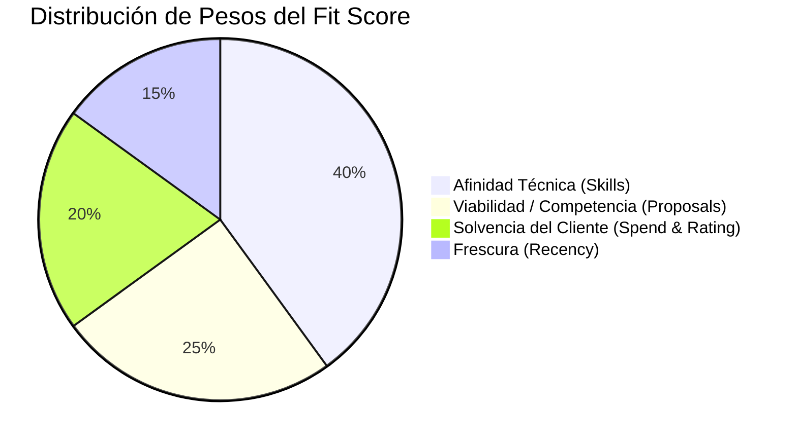

# Fit Score Engine: Especificación y Algoritmo de Calificación (0-100)

> **Documentación Oficial de Arquitectura y Negocio**  
> **Ubicación en Confluence:** `Spotlight Engineering > 02. Architecture & Core Engines > 02.3 Scoring & Intelligence Engine > Fit Score Algorithm & Lead Qualification`  
> **Labels:** `proposal-autopilot`, `scoring-algorithm`, `lead-qualification`, `architecture`, `upwork-automation`  
> **Código Fuente:** [`backend/src/modules/scoring/`](file:///d:/SpotlightProjects/proposal-autopilot/backend/src/modules/scoring/)

---

## 1. Visión General (Para Dummies)

El **Fit Score (0 a 100)** funciona como un **radar detector de oportunidades de oro** en Upwork. Su objetivo es clasificar en milisegundos si una vacante recién extraída merece que le dediquemos tiempo y recursos de IA (generación de propuestas personalizadas y diagramas Mermaid), o si debe ser descartada inmediatamente por ser spam, estar fuera de nicho o provenir de clientes insolventes.

### Semáforo de Calificación:
* 🟢 **HIGH FIT (75 - 100):** Oportunidad de ORO. Cliente solvente, fresca y afín a la especialidad. El sistema genera automáticamente la propuesta ejecutiva y diagrama.
* 🟡 **MEDIUM FIT (45 - 74):** Oportunidad aceptable. Generación de propuesta disponible bajo demanda (1 clic).
* 🔴 **LOW FIT (0 - 44):** Ruido, vacante saturada o cliente no apto. Se descalifica del pipeline.

---

## 2. Diagrama de Ponderación (La Fórmula de los 4 Factores)

El puntaje base se calcula como una suma ponderada de cuatro dimensiones independientes:



$$\text{Puntaje Ponderado} = (S \times 0.40) + (V \times 0.25) + (C \times 0.20) + (R \times 0.15)$$

---

## 3. Desglose Detallado de Cada Factor

### Factor 1: Afinidad Técnica ($S$ - Peso 40%)
*Implementado en:* [`role-classifier.service.ts`](file:///d:/SpotlightProjects/proposal-autopilot/backend/src/modules/scoring/services/role-classifier.service.ts) y [`fit-calculator.service.ts:44-50`](file:///d:/SpotlightProjects/proposal-autopilot/backend/src/modules/scoring/services/fit-calculator.service.ts#L44-L50)

Analiza el texto de la vacante (`title`, `description`, `skills`) contra la taxonomía declarada:

| Categoría Estratégica (`StrategicLane`) | Expresión / Criterio de Búsqueda | Puntos Asignados |
| :--- | :--- | :---: |
| **CORE_AI_UX** | `\b(ai|agent|agents|copilot|llm|llms|genai|gpt|conversational)\b` o `design system`, `component library`, `figma variables` | **85 pts** |
| **PRODUCT_STRATEGY** | `product manager`, `interim`, `0-to-1`, `roadmap`, `cpo` | **75 pts** |
| **INTERFACE_BUILD** | `redesign`, `framer`, `dashboard`, `saas website` | **60 pts** |
| **DISQUALIFIED_NOISE** | `\b(course instructor|tutoring|teach courses|qa checklist|graphic designer|influencer|avatar creator)\b` | **15 pts** |

---

### Factor 2: Viabilidad y Competencia ($V$ - Peso 25%)
*Implementado en:* [`fit-calculator.service.ts:51-55, 98-106`](file:///d:/SpotlightProjects/proposal-autopilot/backend/src/modules/scoring/services/fit-calculator.service.ts#L51-L55)

Premia llegar antes que la competencia y penaliza vacantes sobre-saturadas de propuestas:

* **Base:** Inicia en 65 pts (90 pts si es `CORE_AI_UX`, 30 pts si está descalificado).
* **Modificadores por número de aplicantes (`proposalsCount`):**
  * $\le 5$ propuestas enviadas: **+10 pts de bono** (Ventaja competitiva masiva).
  * $21$ a $50$ propuestas enviadas: **-15 pts de castigo** (Competencia moderada/alta).
  * $> 50$ propuestas enviadas: **-25 pts de castigo** (Saturación crítica; el cliente rara vez leerá nuevas propuestas).

---

### Factor 3: Solvencia y Calidad del Cliente ($C$ - Peso 20%)
*Implementado en:* [`fit-calculator.service.ts:56-84`](file:///d:/SpotlightProjects/proposal-autopilot/backend/src/modules/scoring/services/fit-calculator.service.ts#L56-L84)

Mide la probabilidad de que el cliente pague tarifas de nivel senior:

1. **Gasto Histórico en Upwork (`clientTotalSpend`):**
   * $\ge \$100,000$ USD: **100 pts** (Cliente Enterprise / Tier 1).
   * $\ge \$25,000$ USD: **85 pts** (Cliente recurrente sólido).
   * $\ge \$5,000$ USD: **70 pts**.
   * $\ge \$500$ USD: **55 pts**.
   * $< \$500$ USD o nuevo: **50 pts base**.

2. **Reputación y Verificación:**
   * **Rating $\ge 4.8\bigstar$:** Suma **+10 pts** (máx. 100).
   * **Pago NO verificado:** Resta **-20 pts** (mínimo 20).

3. **Bono Geográfico de Mercado Objetivo:**
   * Si el país del comprador coincide con los países prioritarios del perfil (ej. EE.UU., Reino Unido, Canadá, Australia, Alemania, Irlanda): **+15 pts de bono**.

---

### Factor 4: Frescura de Publicación ($R$ - Peso 15%)
*Implementado en:* [`fit-calculator.service.ts:85-95`](file:///d:/SpotlightProjects/proposal-autopilot/backend/src/modules/scoring/services/fit-calculator.service.ts#L85-L95)

Calcula las horas transcurridas desde la fecha real de publicación (`postedAt`):

| Tiempo Transcurrido | Puntos de Frescura | Justificación Operativa |
| :--- | :---: | :--- |
| $\le 2$ horas | **100 pts** | Ventana óptima de respuesta inmediata. |
| $2$ a $6$ horas | **90 pts** | Alta probabilidad de visualización. |
| $6$ a $12$ horas | **80 pts** | Ventana diurna estándar. |
| $12$ a $24$ horas | **70 pts** | Segunda línea de revisión. |
| $24$ a $48$ horas | **55 pts** | Competencia establecida. |
| $> 48$ horas | **35 pts** | Convocatoria fría o en fase de contratación. |

---

## 4. 🛡️ Las 2 Reglas de Oro de Seguridad (Safety Net Caps)

Para evitar distorsiones donde un cliente con millones de dólares infle un trabajo que no nos interesa realizar:

### Regla A: El Techo de Habilidad (Skill Safety Cap)
> Si `skillScore < 40`, el puntaje general **se topa obligatoriamente en 44** (`CAPPED at 44: skill match under 40`).
> Esto garantiza que ningún empleo fuera de nicho o irrelevante califique como `MEDIUM` o `HIGH`, protegiendo el tiempo del operador.

### Regla B: Filtro Geográfico Estricto (Strict Geo Exclusion)
> Cuando el perfil tiene activo `geoFilterMode === 'STRICT_EXCLUDE'`:
> * Si el cliente está en un país de la lista negra (`excludedCountries`): **Puntaje forzado a 15 (Descalificado)**.
> * Si hay lista de países objetivo (`targetCountries`) y el cliente no pertenece a ella: **Puntaje forzado a 25**.

---

## 5. Mapeo de Código Fuente

```
backend/src/modules/scoring/
├── constants/
│   └── taxonomy.constants.ts          # Definición de StrategicLane y contratos de salida
├── services/
│   ├── fit-calculator.service.ts      # Motor matemático de cálculo y aplicación de caps
│   └── role-classifier.service.ts     # Detección semántica vía regex
└── scoring.module.ts                  # Exportación para inyección de dependencias

backend/src/modules/scraping/
└── scraping.controller.ts             # Ejecución en el pipeline asíncrono (L280-L320)
```

---

## 6. Caso de Ejemplo de Cálculo

### Vacante de Prueba: *"Senior Product Designer - AI Interaction & Design Systems"*
* **Metadatos:**
  * Publicado hace 45 minutos ($\le 2$ h) $\rightarrow R = 100$
  * 3 propuestas enviadas ($\le 5$) $\rightarrow V = 90 + 10 = 100$
  * Cliente en United States, $65k gastados, 4.9★, pago verificado $\rightarrow C = 85 + 10 (\text{rating}) + 15 (\text{geo}) = 100$ (tope)
  * Menciona "AI UX" y "Design System" $\rightarrow S = 85$

$$\text{FitScore} = (85 \times 0.40) + (100 \times 0.25) + (100 \times 0.20) + (100 \times 0.15)$$
$$\text{FitScore} = 34 + 25 + 20 + 15 = \mathbf{94 \ (HIGH \ FIT \ - \ GOLD \ LEAD)}$$

**Acción del Sistema:** Clasificado en el Top 3 Gold. Se sintetiza propuesta con Claude/Gemini, se compila PDF en Gotenberg y se añade a la cola de despacho inmediato.
