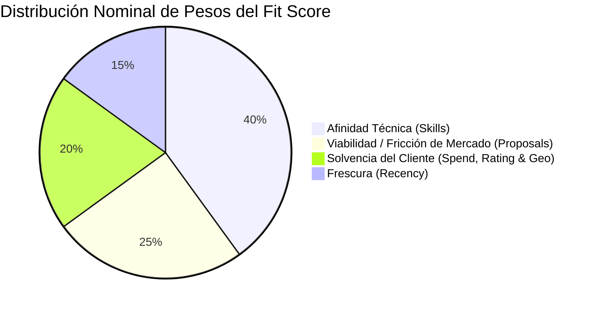

# Fit Score Engine: Especificación Integral y Algoritmo de Calificación (0-100)

> **Documentación Oficial de Arquitectura y Negocio**  
> **Ubicación en Confluence:** `Spotlight Engineering > 02. Architecture & Core Engines > 02.3 Scoring & Intelligence Engine > Fit Score Algorithm & Lead Qualification`  
> **Link Directo Confluence:** [Confluence Page (ID: 384237569)](https://spotlightus.atlassian.net/wiki/spaces/PROPAUTO/pages/384237569)  
> **Archivo Maestro Confluence:** [`docs/confluence/01-fit-score-calculation-engine.md`](file:///d:/SpotlightProjects/proposal-autopilot/docs/confluence/01-fit-score-calculation-engine.md)  
> **Labels:** `proposal-autopilot`, `scoring-algorithm`, `lead-qualification`, `architecture`, `upwork-automation`  
> **Código Fuente:** [`backend/src/modules/scoring/services/fit-calculator.service.ts`](file:///d:/SpotlightProjects/proposal-autopilot/backend/src/modules/scoring/services/fit-calculator.service.ts)

---

## 1. Visión General (Para Dummies)

El **Fit Score (0 a 100)** funciona como un **radar detector de oportunidades de oro** en Upwork. Su objetivo es clasificar en milisegundos si una vacante recién extraída merece que le dediquemos tiempo y recursos de IA (generación de propuestas personalizadas, diagrama Mermaid y CV a la medida), o si debe ser descartada inmediatamente por ser spam, estar fuera de nicho o provenir de clientes insolventes.

### Semáforo de Calificación:
* 🟢 **HIGH FIT (75 - 100):** Oportunidad de ORO. Cliente solvente, fresca y afín a la especialidad técnica. El sistema genera automáticamente la propuesta ejecutiva y diagrama.
* 🟡 **MEDIUM FIT (45 - 74):** Oportunidad aceptable. Generación de propuesta disponible bajo demanda (1 clic).
* 🔴 **LOW FIT (0 - 44):** Ruido, vacante saturada o cliente no apto. Se descalifica del pipeline activo.

---

## 2. Diagrama de Ponderación y Arquitectura Deductiva Bi-Axial

A diferencia de modelos ingenuos que suman puntos ciegamente, el motor de Proposal Autopilot opera de manera **deductiva y contextual**:
1. **Punto de Partida:** Inicia evaluando el **potencial del rol** contra el perfil de posicionamiento activo (`baseFitScore` de 35 a 100).
2. **Deducciones por Fricción:** Aplica penalizaciones objetivas por saturación de mercado, falta de solvencia del cliente o datos incompletos.
3. **Ponderación Adaptativa del Perfil:** Aplica los pesos relativos configurados por el usuario para su perfil específico.
4. **Multiplicador Semántico de Rol:** Ajusta la relevancia en base al árbol de roles (`Core`, `Hybrid`, `Tangential` o `Excluded`).
5. **Techos de Seguridad Inviolables (Caps):** Si se detecta un país excluido o un rol incompatible, el puntaje es forzado a niveles de descalificación sin importar qué tan solvente sea el cliente.



$$\text{Puntaje Compuesto Nominal} = \frac{S \cdot 40 + V \cdot 25 + C \cdot 20 + R \cdot 15}{100}$$

$$\text{Puntaje Compuesto Personalizado} = \frac{S \cdot W_{skill} + V \cdot W_{ai} + C \cdot W_{client} + R \cdot W_{recency}}{W_{skill} + W_{ai} + W_{client} + W_{recency}}$$

$$\Delta_{ajuste} = \text{round}(\text{Puntaje Personalizado} - \text{Puntaje Nominal})$$

$$\text{Score Base} = \text{clamp}_{15}^{100}(\text{baseFitScore} - \text{Deducciones} + \Delta_{ajuste})$$

---

## 3. Desglose Detallado de Cada Factor

### Factor 1: Afinidad Técnica ($S$ - Peso 40%)
*Implementado en:* [`role-classifier.service.ts`](file:///d:/SpotlightProjects/proposal-autopilot/backend/src/modules/scoring/services/role-classifier.service.ts) y [`fit-calculator.service.ts`](file:///d:/SpotlightProjects/proposal-autopilot/backend/src/modules/scoring/services/fit-calculator.service.ts)

* **DIRECT_MATCH:** Coincidencia exacta con expresiones clave primarias $\to$ `baseFitScore = 95 - 100 pts`.
* **PARTIAL_MATCH:** Coincidencia contextual o secundaria $\to$ `baseFitScore = 75 - 85 pts`.
* **OFF_NICHE:** La vacante pertenece a software/diseño pero no al stack específico del perfil $\to$ `baseFitScore = 40 pts` (topado a máx 35).
* **DISQUALIFIED / INCOMPATIBLE:** Roles ajenos (asistencia virtual, telemarketing, data entry, edición de video) $\to$ `baseFitScore = 15 - 25 pts` (topado a máx 25).

### Factor 2: Viabilidad y Fricción de Mercado ($V$ - Peso 25%)
*Implementado en:* [`fit-calculator.service.ts:85-105`](file:///d:/SpotlightProjects/proposal-autopilot/backend/src/modules/scoring/services/fit-calculator.service.ts#L85-L105)

* $\le 5$ propuestas: **100 pts** (Ventana de oro: primeros en postular).
* $6$ a $15$ propuestas: **85 pts** (Deducción de -5 pts).
* $16$ a $50$ propuestas: **55 pts** (Deducción de -15 pts).
* $> 50$ propuestas: **20 pts** (Mercado saturado: deducción de -30 pts).

### Factor 3: Solvencia y Calidad del Cliente ($C$ - Peso 20%)
*Implementado en:* [`fit-calculator.service.ts:107-140`](file:///d:/SpotlightProjects/proposal-autopilot/backend/src/modules/scoring/services/fit-calculator.service.ts#L107-L140)

* **Gasto histórico verificado:**
  * $\ge \$10,000$ USD: **+15 pts de bono** (Cliente solvente).
  * $\$1,000$ a $\$9,999$ USD: Puntuación neutral.
  * $< \$1,000$ USD: **Deducción de -5 pts**.
  * $\$0$ USD: Deducción de -5 pts si el pago está verificado; -15 pts si no tiene validación.
* **Rating & Pago:**
  * Rating $< 4.5$ estrellas: **Deducción de -10 pts**.
  * Pago verificado: **85 pts base**.
  * Pago no verificado: **30 pts base** (Deducción severa de **-20 pts**).

### Factor 4: Frescura y Recency ($R$ - Peso 15%)
*Implementado en:* [`fit-calculator.service.ts:142-163`](file:///d:/SpotlightProjects/proposal-autopilot/backend/src/modules/scoring/services/fit-calculator.service.ts#L142-L163)

* $< 3$ horas: **100 pts**
* $3$ a $24$ horas: **95 pts**
* $24$ a $72$ horas: **90 pts**
* $3$ a $7$ días: **85 pts**
* $7$ a $21$ días: **75 pts**
* $> 21$ días: **60 pts**

---

## 4. 🛡️ Las Reglas de Seguridad (Safety Caps y Estados Ortogonales)

Para garantizar total transparencia operativa, el motor separa tres conceptos ortogonales:

1. **`eligibilityStatus` (`ELIGIBLE` | `PENDING` | `EXCLUDED`):**
   * Determina si el cliente y la vacante son legal y geográficamente aptos. Si el país está en `excludedCountries`, pasa a `EXCLUDED` y el score se fuerza a $\le 15$.
2. **`dataQualityStatus` (`COMPLETE` | `INCOMPLETE`):**
   * Indica si Apify proveyó todos los campos (`proposalsCount`, `postedDate`). Si falta alguno, el score se topa a un máximo de 88 puntos (nunca se regala un 100 ficticio).
3. **`isCapped` (`boolean`) & `capReason`:**
   * **Incompatible Cap:** Topado en $\le 25$ pts.
   * **Disqualified Cap:** Topado en $\le 25$ pts.
   * **Off-Niche Cap:** Topado en $\le 35$ pts.
   * **Geo Exclusion Cap:** Topado en $\le 15$ pts.

---

## 5. Mapeo de Código Fuente

```
backend/src/modules/scoring/
├── constants/
│   └── taxonomy.constants.ts          # StrategicLane, RoleClassification, FitScoreOutput
├── services/
│   ├── fit-calculator.service.ts      # Motor matemático de cálculo, normalización y caps
│   ├── fit-calculator.spec.ts         # Suite de 11 pruebas adversarias (TDD)
│   ├── role-classifier.service.ts     # Detección semántica context-aware
│   └── deterministic-semantic.service.ts # Eje bi-axial de roles (Core/Hybrid/Tangential)
└── scoring.module.ts                  # Inyección de dependencias
```
